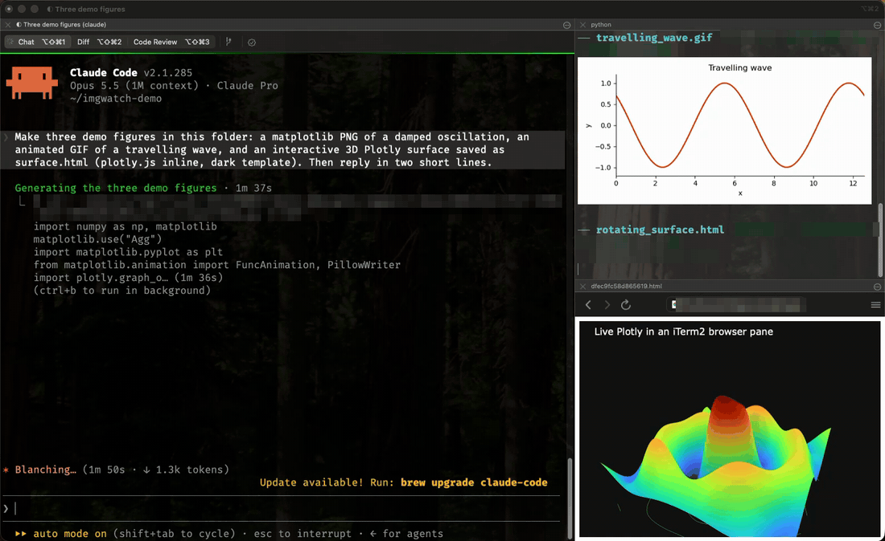

# claude-imgwatch

A live media pane for Claude Code in iTerm2. Every interactive `claude` session gets its own
split pane that shows the files that session produces or opens, as they appear:

| File | Shown as |
|---|---|
| PNG, JPEG, GIF, WebP, TIFF, BMP, SVG, HEIC | inline image (GIFs animate; HEIC via `sips`) |
| many stills at once | one labelled contact sheet |
| MP4, MOV, WebM, … | animated-GIF preview of the first 8 s |
| PDF | first page inline, "page 1 of N", name links to the file |
| HTML (Plotly, Bokeh, …) | live page in an iTerm2 browser pane |
| PDB, mmCIF, BinaryCIF, MOL2, single 3D SDF/MOL | interactive Mol* viewer in the browser pane |
| SMILES list (`.smi`), 2D or multi-molecule SDF/MOL | RDKit grid, dark style (white carbons), names as legends |
| PyMOL session (`.pse`) | ray-traced snapshot of the saved view (headless PyMOL) |
| PowerPoint, Word, Excel, Keynote, Pages, Numbers | first slide/page (Quick Look) |

Every header's file name and folder are clickable (cmd-click opens them).

Files show up when Claude reads or writes them, when they appear in the session's scratch dir or
working dir, **or when a Bash command or MCP tool mentions a media file it just wrote** (a script
that prints `saved figure to …`, a PyMOL `png …` through an MCP server), wherever that file is.



macOS + iTerm2 (inline-image protocol, AppleScript, Python API). WezTerm, kitty and Ghostty
support is experimental and untested (see below).

## Quick start
```bash
git clone https://github.com/hilgersmt/claude-imgwatch ~/src/claude-imgwatch
cd ~/src/claude-imgwatch && ./setup.sh
```
`setup.sh` walks you through it in about 10 minutes: picks a Python, offers each optional extra
(explaining what it's for, installing only if you say yes), installs, then guides you through the two
manual iTerm2/macOS steps with exact clicks and checks each one worked before moving on, and ends
with a live demo pane that asks you what you see. Re-run any time; `./setup.sh --demo` repeats just
the demo. Prefer Claude to drive? Open `claude` in the repo and ask it to set up imgwatch: the repo's
`setup-imgwatch` skill makes it do the same steps, verifying each one. Unattended installs:
`./install.sh` (below).

## Versions
Releases are git tags (`v0.0.5`, …); see [CHANGELOG.md](CHANGELOG.md). `imgwatch -V` and the pane banner
show which one a machine runs, e.g. `v0.0.5 (1a2b3c4)`. Update with `git pull`.

## Reference versions (work Mac, 2026-11-13, all verified working together)

| Component | Version | Needed for |
|---|---|---|
| macOS | 26.5.1, arm64 | |
| iTerm2 | **3.7.3** | inline images (any 3.x); **Browser profiles need 3.7+** |
| Claude Code | 2.1.285 | `SessionStart` / `PostToolUse` hooks with `session_id`, `cwd`, `tool_input` on stdin |
| Python | 3.13.9 (Anaconda, `/opt/anaconda3/bin/python`) | stdlib is enough for stills |
| `iterm2` (pip) | 2.30 | HTML browser lane |
| `selenium` (pip) | 4.52.0 + Google Chrome 157 | HTML screenshot lane |
| `watchdog` (pip) | 4.0.2 | FSEvents instead of polling (optional) |
| Pillow (pip) | 11.3.0 | contact sheets, trimming Quick Look padding (optional) |
| Mol* | 5.10.1 (fetched once from jsDelivr into `~/.claude/imgwatch/vendor/`) | structures |
| ffmpeg | 8.0.1 (Homebrew, `/opt/homebrew/bin/ffmpeg`) | video lane |
| plotly | 6.4.0 | only for making test figures |

Pip gotchas seen with Anaconda:
- `pip install iterm2` pulls protobuf 7, which breaks streamlit 1.45. Pin back with
  `pip install --ignore-installed certifi 'protobuf<7'` (6.33.6 works for both).
- A plain `pip install selenium` fails trying to uninstall conda's RECORD-less certifi; use
  `pip install --ignore-installed certifi selenium`.

## Install / update

```bash
git clone <this repo> ~/src/claude-imgwatch
~/src/claude-imgwatch/install.sh -n    # dry run: shows what it would back up / link / add
~/src/claude-imgwatch/install.sh
imgwatch --doctor                       # re-check any time
```

`install.sh` is idempotent. It:
1. Writes `~/.config/imgwatch/config` if missing (picks the first Python that can `import iterm2`;
   edit it afterwards if that guess is wrong). An existing config is never touched.
2. Symlinks `~/bin/imgwatch`, `~/bin/imgpane`, `~/.claude/hooks/imgpane-autostart.sh`,
   `~/.claude/hooks/imgwatch-enqueue.sh` into the repo. Any existing non-symlink file at those
   paths is moved to `~/bin/backups/imgwatch_pre-repo_<stamp>/` first.
3. Copies `~/.claude/settings.json` to `~/.claude/backups/settings.json.<stamp>`, then *adds* the
   two hook entries if they are not there. Other hooks and settings are left alone.
4. If no iTerm2 profile named `imgbrowser` exists, installs one as a Dynamic Profile
   (`~/Library/Application Support/iTerm2/DynamicProfiles/imgwatch.json`, from
   `iterm2/imgbrowser.dynamic-profile.json`; the key that makes it a browser is
   `"Custom Command": "Browser"`). An existing profile of that name is never touched.
5. Runs `imgwatch --doctor`.

Updating later = `git pull` (the symlinks pick it up; the next new Claude session uses it).

### iTerm2 setup (manual, once)
**Settings → General → Magic → Enable Python API** (browser lane). The `iterm2` module then
connects without a prompt; the first `osascript` call may trigger a macOS Automation prompt for
"iTerm2 controlling iTerm2": allow it (pane splitting needs it).

The `imgbrowser` Browser profile is created by `install.sh` (tested: the Dynamic Profile works
exactly like one made in Settings → Profiles → `+` → type *Browser*). Check with
`/Applications/iTerm.app/Contents/Resources/utilities/it2 profile list`. No browser profile
wanted? Set `IMGWATCH_BROWSER_PROFILE=` (empty) in the config and HTML/structures fall back to
headless screenshots (or a clickable link without selenium).

## How it works

```
claude (iTerm2 pane)                               imgwatch pane (right, ~1/3 width)
 │ SessionStart hook ── imgpane-autostart.sh ──► imgpane (AppleScript split) ──► imgwatch --owner PID --session SID
 │ PostToolUse(Read|Write) ── imgwatch-enqueue.sh ──► ~/.claude/imgwatch/queue ──► (tailed, filtered by SID)
 │ figures written to scratch dir / cwd  ───────────────────────────────────────► (polled every 1 s)
 └ exits ───────────────────────────────────────────────────────────────────────► watcher sees owner gone, exits, pane closes
                                                     HTML ──► iTerm2 browser pane (below, via Python API)
```

### 1. `hooks/imgpane-autostart.sh` (SessionStart)
- Only runs when `TERM_PROGRAM=iTerm.app` with an `ITERM_SESSION_ID`, for interactive sessions
  (`CLAUDE_CODE_ENTRYPOINT` unset or `cli`, so `claude -p` / SDK runs are skipped), and not when
  `CLAUDE_NO_IMGPANE` is set (`CLAUDE_NO_IMGPANE=1 claude` = opt out for one launch).
- Skipped inside `screen`/`tmux` (`$STY`/`$TMUX` set, e.g. a detached `claude --remote-control`
  session): `ITERM_SESSION_ID` is inherited from where it was started, so the split would land there.
- Reads `session_id` and `cwd` from the hook JSON on stdin.
- Finds the owning Claude CLI PID: `$CLAUDE_PID` if set, else walks up the parent chain to the
  first process whose `comm` contains `claude`.
- Dedup: looks for a watcher with `pgrep -f '^[^ ]+ [^ ]*/imgwatch\.py --owner <PID>( |$)'`.
  Same session id → it's a resume/compact, keep the pane. Different session id → it's `/clear`,
  kill the old watcher (its pane closes) and open a new one. The pattern is anchored on
  "`<interpreter> <path>/imgwatch.py`" so it never matches the `zsh -c` wrapper or a shell that
  merely mentions imgwatch. **If you change how imgwatch is launched, re-check this with
  `pgrep -fl imgwatch`**: a mismatch gives duplicate panes or stale ones after `/clear`.
- Starts `imgpane --owner PID --session SID [--browser-profile NAME]` in the background from the
  session's cwd.

### 2. `bin/imgpane` (AppleScript)
- Finds the iTerm2 session matching `$ITERM_SESSION_ID` (falls back to the current session),
  `split vertically with default profile command "/bin/zsh -c 'cd <cwd> && imgwatch …'"`. There's no
  interactive shell in the pane, so it closes when imgwatch exits.
- Width: `IMGPANE_WIDTH` = percent of the tab (default 33) or `<n>c` columns; minimum 20.
  Setting a pane's `columns` in iTerm2 resizes the **whole window**, so imgpane saves the window
  bounds, then up to 5 rounds of "set columns → restore bounds" (0.1 s delays) until it converges.
- Gives focus back to the Claude pane.
- Manual use: `imgpane [imgwatch args…]`, e.g. `imgpane -w 80% ~/figs`.

### 3. `hooks/imgwatch-enqueue.sh` (PostToolUse, all tools)
- Read/Write/Edit: if `tool_input.file_path` has a media extension, appends
  `session_id<TAB>path` to `~/.claude/imgwatch/queue` (always, even for old files).
- Bash and `mcp__*` tools: scans the tool input and response text for media extensions; each hit
  is grown leftwards to the longest string that is an existing file, so paths with spaces work
  (OneDrive). Queued only if modified in the last 3 minutes and not under `~/.claude/imgwatch`.
  Other tools (Grep, Glob, …) are ignored, so listings don't flood the pane.
- Runs with `python -S` (≈17 ms per call); always exits 0 so it can never block Claude.
  Installs from before this change registered it for `Read|Write` only; `install.sh` widens that
  and the doctor warns about it.
- Note that when Claude `Read`s an image it also costs context (vision); writing figures into a
  polled dir shows them for free.

### 4. `bin/imgwatch` → `bin/imgwatch.py`
`bin/imgwatch` is a 3-line launcher: sources the config (with `set -a`, so the values are exported)
and `exec`s `$IMGWATCH_PYTHON imgwatch.py`. The watcher loop, every `--interval` (1 s):
- **Queue**: reads new bytes since the last offset (resets if the file shrank), skips lines
  whose session id isn't `--session`, and shows every remaining path, *even if already shown*.
- **Watching**: the session's scratch dir(s) `/private/tmp/claude-<uid>/*/<session_id>`
  (re-globbed every loop since it appears lazily) plus the cwd unless the cwd is `~` (never
  watches all of home). With `watchdog` installed this uses macOS FSEvents (one recursive watch
  per root, events filtered to media files), so a big project cwd costs nothing between changes;
  without it (or with `--poll`) it rescans every second. Depth `--depth` 5; skips dot-dirs,
  `node_modules`, `.git`, `__pycache__`, `Library`. Existing files are never replayed; new or
  changed mtime → shown.
- **Batching**: new files are collected until 0.5 s pass without another (max 3 s), then the
  sizes must stop changing (max 3 s). More than `--burst` (6) stills in one batch become one
  contact sheet (3–5 columns, file names under each tile; needs Pillow, else the last 3 are
  drawn and the rest listed).
- **Owner check**: `os.kill(owner, 0)`; gone → exit. On exit (owner gone, SIGTERM from `/clear`,
  SIGHUP when the pane is closed, Ctrl-C) it also closes its browser pane (`--keep-browser`
  to leave it) and deletes the pane's state file.
- **Housekeeping at start**: cache files older than `--cache-days` (7) are deleted, then the
  oldest until the cache is under `--cache-mb` (500); the queue is cut to its last 64 kB once it
  passes 1 MB (other watchers notice it shrank and continue from the new end); stale
  `browser_session_*` files (> 1 day) are removed.
- **Resize**: SIGWINCH sets a flag; after 0.4 s with no further resize it clears screen *and*
  scrollback (`ESC]1337;ClearScrollback`, because iTerm2 keeps stale, mis-sized images there) and
  redraws the last `--keep` (4) items, since inline images are sized at draw time.

Rendering per type (each item gets a cyan header: name, time, folder; name and folder are
OSC 8 hyperlinks, so cmd-click opens the file in its default app or the folder in Finder):
- **Stills** `.png .jpg .jpeg .gif .webp .tif .tiff .bmp`: `imgcat -l -W <width>` (iTerm2's
  bundled `/Applications/iTerm.app/Contents/Resources/utilities/imgcat`). `-l` = legacy
  single-sequence mode. The multipart protocol garbles when two writers interleave.
- **HEIC/HEIF** (iPhone photos): converted to JPEG with `sips`, cached, then imgcat.
- **SVG**: rasterised with Quick Look (`qlmanage -t -s 1200`), padding trimmed (Quick Look pads
  to a square), cached, then imgcat.
- **PDF**: Quick Look renders page 1 the same way; the header says "page 1 of N" (Spotlight's
  page count, or counted from the file when it isn't indexed, e.g. in /tmp).
- **Video** `.mp4 .mov .m4v .webm .avi .mkv .mpg .mpeg`: ffmpeg →
  `fps=N,scale=W:-1:flags=lanczos,split[s0][s1];[s0]palettegen[p];[s1][p]paletteuse`, loop
  forever, first `--video-seconds` only; iTerm2 animates GIFs inline. Cached in
  `~/.claude/imgwatch/cache/<sha1(path|mtime|params)>.gif` so a resize doesn't re-transcode.
  Missing, failed or timed-out (180 s) ffmpeg prints a warning and doesn't crash.
- **HTML** `.html .htm`, three lanes (`--html-mode auto` = browser if a browser profile is
  given, else shot if selenium imports, else link; files over `--html-max-mb` are skipped):
  - **browser**: on first use, splits the *imgwatch* pane horizontally with the Browser
    profile (`iterm2` API, `async_split_pane(vertical=False, profile=…)`), stores its session id
    in `~/.claude/imgwatch/browser_session_<session id>` and reuses it (re-splits if it was closed). Each page
    goes in with `async_load_url`. Two gotchas:
    - iTerm2's browser rejects `file:///path` ("Invalid URL") but accepts `file://localhost/path`.
    - The original page is never loaded directly. A cached copy goes in
      (`cache/<hash>.html`) with `<base href="file://localhost/<original dir>/">`, so relative
      assets still resolve, plus an injected script that runs `Plotly.Plots.resize` on load,
      +300 ms, +1 s and on every ResizeObserver tick, and relayouts fixed-width figures wider
      than the pane down to the pane width. The pane's address bar therefore shows the cache path.
    - A brand-new browser pane shows iTerm2's onboarding page until the first URL loads.
  - **shot**: headless Chrome via selenium, viewport `--shot-px` (1400) wide at 2× scale,
    waits `--shot-wait` (2 s) for JS, grows the window to the page height (max 4000) and
    screenshots. Chrome **must** get `--use-gl=angle --use-angle=swiftshader
    --enable-unsafe-swiftshader` (not `--disable-gpu`), or Plotly 3D / Mol* screenshot as
    "WebGL is not supported". Cached like video.
  - **link**: prints an OSC 8 `file://` hyperlink (cmd-click opens the default browser).
- **Compounds** `.smi/.smiles` (one `SMILES [name]` per line; header and `#` lines skipped; CXSMILES
  extensions stripped), and `.sdf/.mol` that are 2D or hold several molecules: RDKit grid, 4 per
  row, 320×240 panels, transparent background with white carbons, names (or `#n`) as legends;
  unreadable entries are counted. Needs RDKit in `IMGWATCH_PYTHON`.
- **PyMOL sessions** `.pse`: `pymol -qc` in a subprocess loads the session and ray-traces
  1200×900 from its saved view (opaque background, 120 s timeout; PyMOL runs with the cache as
  its working dir, so nothing is ever written next to the session). Cached by path + mtime.
- **Office / iWork** `.pptx .ppt .docx .doc .xlsx .xls .key .pages .numbers`: Quick Look's
  first-slide/page thumbnail (macOS renders these natively, no Office needed). Not trimmed (only
  SVG thumbnails are, so page margins stay intact).
- **Structures** `.pdb .ent .cif .mmcif .bcif .mol2` and single 3D `.sdf/.mol`: a self-contained Mol* page
  (`cache/<hash>_<name>.html`: Mol* JS/CSS inlined, the structure embedded as text or, for
  BinaryCIF, base64 → `Uint8Array`, loaded with `viewer.loadStructureFromData`) goes through the
  same HTML lanes. Embedding avoids `file://` fetches, which the browser pane may block. Mol* is
  downloaded once from jsDelivr (`IMGWATCH_MOLSTAR_VERSION`, default 5.10.1). Minimal UI, dark
  background, sequence panel on. In link mode the link opens that page in your browser.
  The browser pane is only ever reused (or closed) if it is in the same iTerm2 tab as the
  watcher, so one session can never take over another's.

### Flags (imgwatch)
| Flag | Default | |
|---|---|---|
| `dirs…` | scratch dir + cwd | explicit dirs to poll instead |
| `-w/--width` | `100%` | imgcat width (`80`, `600px`, …) |
| `-i/--interval` | 1.0 | poll seconds |
| `-d/--depth` | 5 | scan depth |
| `--no-poll` | off | queue only |
| `-k/--keep` | 4 | items redrawn after resize |
| `--owner PID` | | exit when PID ends |
| `-s/--session ID` | | filter queue + poll that session's scratch dir |
| `--video-seconds` / `--video-fps` / `--video-px` / `--no-video` | 8 / 10 / 720 / off | video preview |
| `--html-mode` | auto | `browser`, `shot`, `link`, `off` |
| `--browser-profile` | `$IMGWATCH_BROWSER_PROFILE` | iTerm2 Browser profile name |
| `--shot-wait` / `--shot-px` / `--html-max-mb` | 2 / 1400 / 40 | screenshot lane; size cap also applies to structures |
| `--keep-browser` | off | leave the browser pane open on exit |
| `--pymol CMD` | `$IMGWATCH_PYMOL` or this python | interpreter that can `import pymol`, for `.pse` |
| `--max-mols N` | 48 | molecules per compound grid |
| `--poll` | off | poll even if watchdog is installed |
| `--burst N` | 6 | more than N stills together → contact sheet (0 = never) |
| `--cache-days` / `--cache-mb` | 7 / 500 | cache pruning at start |
| `-V/--version` | | print commit + date (also in the banner) |
| `--doctor` | | check the installation (below) |

### `imgwatch --doctor`
Checks, each reported ok / warn / FAIL (exit 1 on any FAIL): config and interpreter; iTerm2
version (3.7+ for browser panes) and imgcat; Python modules (`iterm2`, `selenium`, `watchdog`,
Pillow); ffmpeg; Chrome; Mol* cache; iTerm2 Python API enabled; the browser profile exists and
is Browser-type; both hooks are in `settings.json`, executable, and are this repo's copies;
`~/bin` links point here; the enqueue hook's extension list matches what imgwatch handles; and
it starts a throwaway watcher to prove the autostart hook's `pgrep` pattern matches it.

### Config (`~/.config/imgwatch/config`, see `config.example`)
`IMGWATCH_PYTHON`, `IMGWATCH_BROWSER_PROFILE` (default `imgbrowser`; empty = no browser lane),
`IMGPANE_WIDTH`, optionally `IMGWATCH_MOLSTAR_VERSION` and `IMGWATCH_PYMOL`. These have to live here: env vars in `~/.zshrc` do **not** reach the pane,
which runs imgwatch without a login shell.

### Runtime state (`~/.claude/imgwatch/`)
`queue` (append-only, shared by all sessions; safe to truncate any time), `cache/` (GIF/PNG/HTML
previews, Mol* pages, contact sheets; pruned at start; safe to delete), `vendor/` (Mol*), `browser_session_<session id>` (id of that session's reusable browser pane; `browser_session` without `--session`).

### Other terminals (experimental, untested)
The pane opener and image drawing have branches for **WezTerm** (iTerm2 image protocol written
directly; split with `wezterm cli split-pane`) and **kitty / Ghostty** (kitty graphics protocol,
PNG chunks; GIFs show their first frame; kitty splits with `kitty @ launch --location=vsplit`,
which needs `allow_remote_control` in kitty.conf; Ghostty has no split CLI, so start
`imgwatch --owner … --session …` in a split yourself). There are no browser panes outside
iTerm2: HTML and structures fall back to screenshots. None of this has been run yet.

## Automated tests
`tests/run.sh` (about a minute; `-k` keeps the temp dir with logs) runs everything that doesn't
need a real pane, against a throwaway `HOME`, so your install, queue, cache and settings are never
touched: syntax; the enqueue hook's filter and line format; `install.sh` on an empty home
(links, settings merge, browser profile, idempotent second run, clean doctor including the pgrep
check); cache/queue pruning; and a headless watcher in link mode fed a PNG, a burst of 8 (contact
sheet), SVG, a 3-page PDF, HTML, a PDB (Mol* page with the data embedded), an mp4 (GIF preview),
a SMILES list, 2D and 3D SDFs, a PyMOL session and a PowerPoint deck, plus queue lines for its own
and another session; the hook is fed Bash/MCP/Grep events (paths with spaces, stale files, its own
cache); an old `Read|Write` hook is widened by `install.sh`. Missing optional pieces (ffmpeg,
Pillow, RDKit, PyMOL, python-pptx, network for Mol*) are reported as SKIP. Last run on the
reference Mac: 36 passed.

## Test checklist (in a real pane)
1. Start `claude` in iTerm2: a right pane titled imgwatch opens and focus stays on the left.
2. Ask Claude for a matplotlib PNG, an SVG and an animated GIF in its scratch dir: all three
   appear, the GIF animates, the SVG is rasterised.
3. Ask it to `Read` one of the PNGs: it appears again (queue route).
4. Ask for a Plotly HTML (2D and 3D): it opens in a browser pane below imgwatch, hover/rotate
   work, and it refits when you drag the divider.
5. An mp4 (e.g. a matplotlib animation; even pixel dimensions or libx264 fails): plays as a GIF.
   A multi-page PDF: page 1 with "page 1 of N". Ten PNGs written at once: one contact sheet.
   A `.pdb`/`.cif`/`.sdf`: rotatable Mol* view in the browser pane.
6. Drag the divider: the pane clears and redraws the last 4 items at the new width.
7. `/clear` → old pane (and its browser pane) closes, new one opens. Quit Claude → both close.
   Two Claude tabs → each pane shows only its own session's media, in its own browser pane.

## Uninstall
Remove the two hook entries from `~/.claude/settings.json`, delete the four symlinks,
`~/.config/imgwatch`, `~/.claude/imgwatch` and (if installed) `DynamicProfiles/imgwatch.json`. Pre-install files are in `~/bin/backups/imgwatch_pre-repo_*`.
